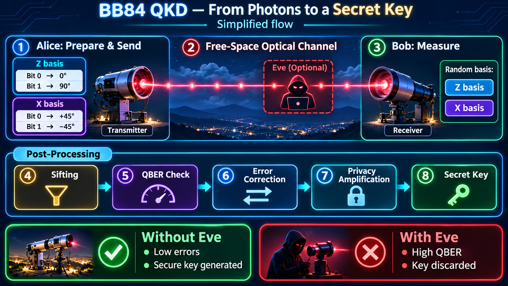
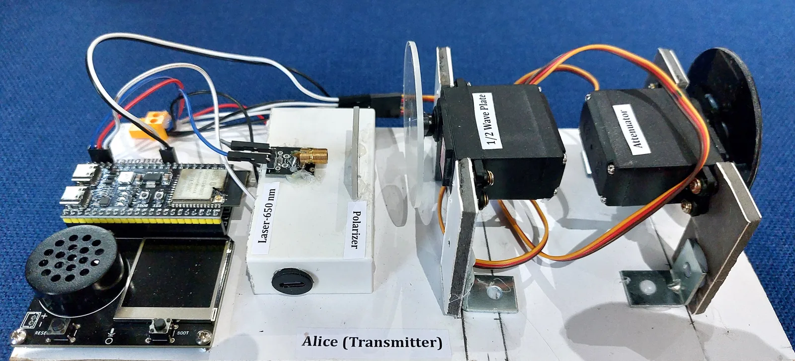
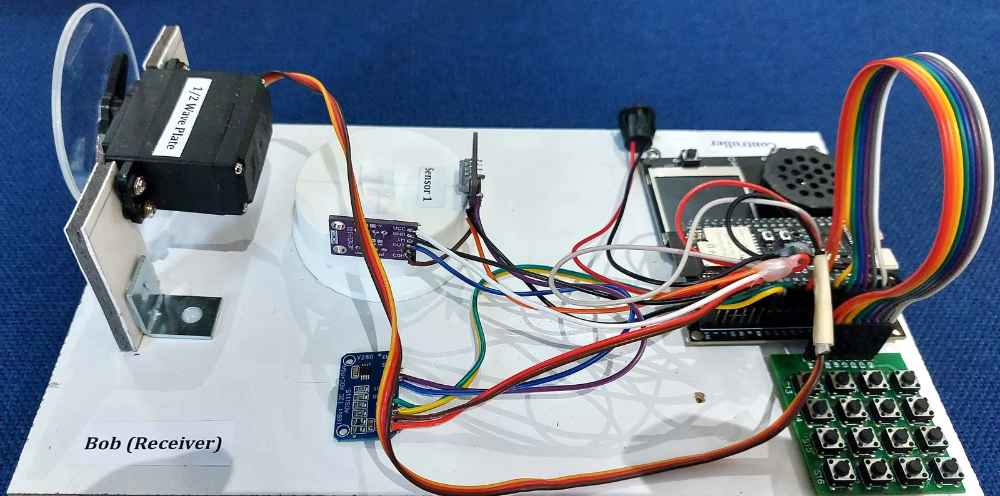
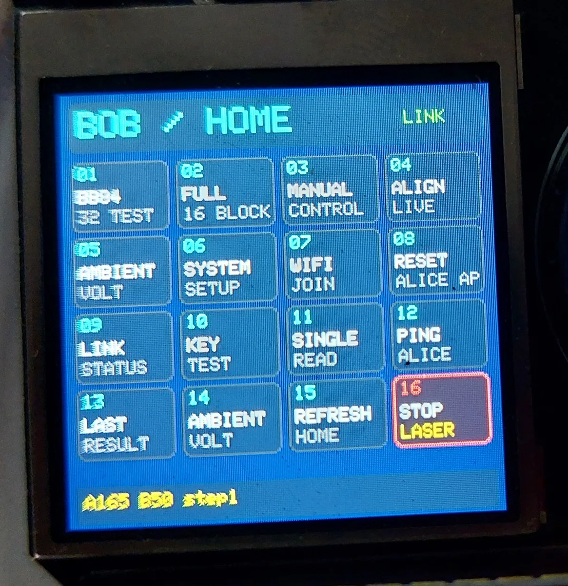
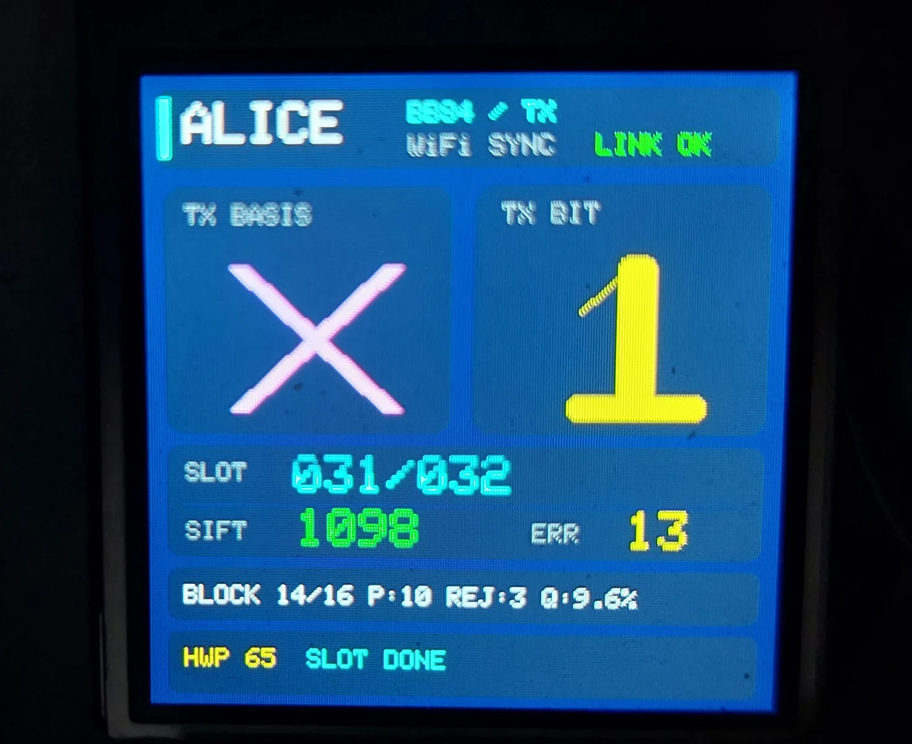
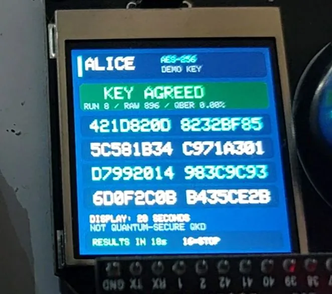
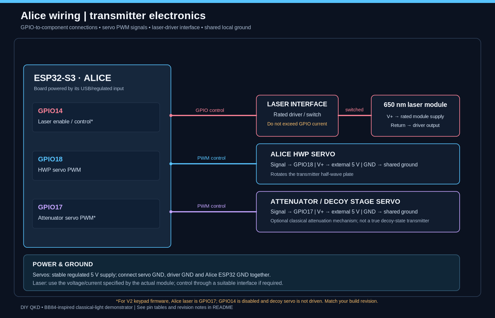
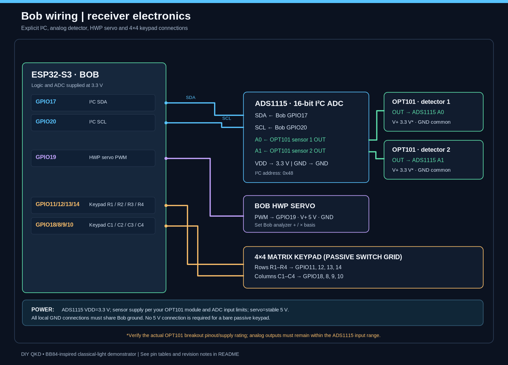
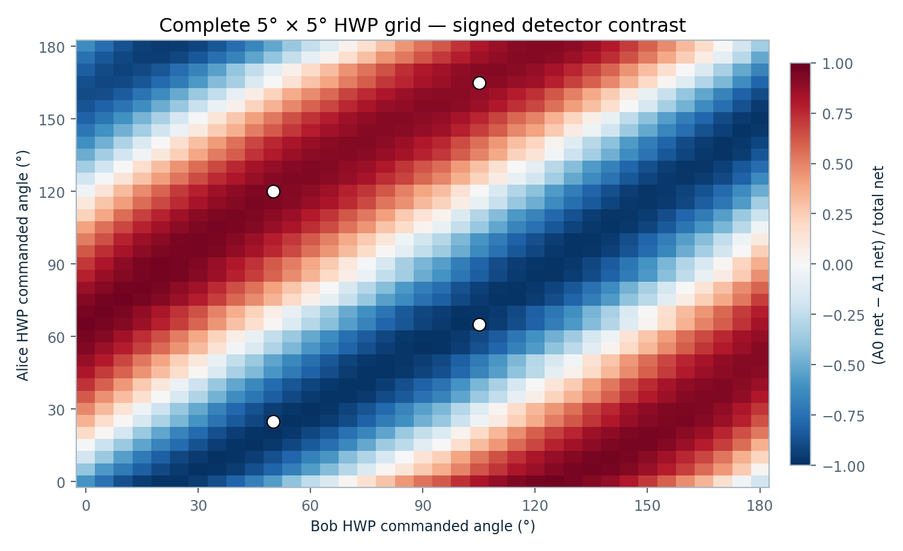

<div align="center">

# 🔐 DIY Quantum Key Distribution (QKD)
### A hands-on, BB84-inspired Alice & Bob optical demonstrator

**ESP32-S3 · Free-space optics · Polarization · Calibration · Key-processing experiments**

**[📖 View the complete illustrated project report](https://limnesh.github.io/QKDDevicesDIY/)** · **[🎬 Watch the complete video series](https://www.youtube.com/playlist?list=PLFDmCrpFyzEY)** · **[🔌 Wiring diagrams](#hardware-and-wiring)** · **[📊 Calibration results](#optical-calibration-and-measured-results)**

</div>



> [!IMPORTANT]
> **Educational demonstration, not quantum-secure QKD.** This project uses a conventional 650 nm laser, polarization optics and analog photodiodes to *simulate key parts of the BB84 workflow*. It does **not** prepare and measure security-validated single-photon quantum states, and its 256-bit output must not be treated as a cryptographically secure key for real systems. A practical QKD implementation needs suitable quantum optical sources and detectors, authenticated classical communication, security analysis and careful device/side-channel controls.

## Overview

Can a low-cost, homemade optical setup demonstrate how **Alice** (a transmitter) and **Bob** (a receiver) use different polarization bases to establish matching bit strings? This project explores that question with two ESP32-S3 devices, servo-driven half-wave-plate optics, a polarizing beam splitter (PBS), and two OPT101 light sensors read through an ADS1115 ADC.

The build supports **manual optical alignment**, **randomized optical transmission**, **basis sifting**, **detector-voltage analysis**, **sampled QBER checks**, and a **demonstration of error reconciliation and Toeplitz-based 256-bit output generation**. It also includes an optional Eve/eavesdropping teaching scenario.

The practical objective is to make the physics, electronics and software stages understandable and reproducible—not to claim quantum-secure communications.

### At a glance

| Item | This project |
|---|---|
| Protocol concept | BB84-inspired polarization encoding using classical light |
| Devices | Two ESP32-S3 boards: Alice (transmitter) and Bob (receiver) |
| Optical path | Free-space 650 nm visible laser, polarization film, HWP optics, PBS |
| Receiver | Dual OPT101 analog detectors + ADS1115 16-bit ADC |
| Control channel | ESP32 Wi-Fi / TCP, separate from the optical path |
| Firmware in repository | **ColorSync V7**, PlatformIO / Arduino framework |
| Demonstrated processing | 32-slot trains, basis sifting, sampled QBER, sparse-parity reconciliation, Toeplitz 896 → 256 |
| Calibration dataset | **3,587** logged voltage rows; complete **1,369-point** 5° × 5° grid |
| Validation | 4.5 m recorded calibration checks; approximately 5 m demonstration shown in video |

## 📷 Actual Alice and Bob hardware

These are photographs of the completed educational prototype. For additional build photos and descriptions, see the **[illustrated project website](https://limnesh.github.io/QKDDevicesDIY/)**.

| Alice — transmitter | Bob — receiver |
|---|---|
|  |  |

### On-device controls and experimental results

| Bob control menu | Eve-interception simulation | Successful demo-key agreement |
|---|---|---|
|  |  |  |
| On-device menu for running tests, alignment and settings. | During the **simulated Eve interception**, errors were observed and candidate blocks were rejected. The pictured run displays **REJ: 3** and **Q: 9.6%**. | A separate successful run displays **KEY AGREED**, **RAW 896** and **QBER 0.00%**, with a matching 256-bit *demonstration* output. |

**Interpretation:** These are firmware-reported educational results. The simulated Eve scenario is not a validated security test, and the classical-light setup does not provide quantum-secure key material.

## 🎬 Three-part video series

| Part | Video | Focus |
|---|---|---|
| **01** | **[QKD Theory — BB84 Protocol](https://www.youtube.com/watch?v=QQfdprppMUg)** | Quantum threat, BB84 bases, sifting, QBER, reconciliation and privacy amplification concepts |
| **02** | **[Schematics — Alice, Bob & Eve](https://www.youtube.com/watch?v=PlUNMTqOUZk)** | ESP32 electronics, optical components, sensors, servos and eavesdropping models |
| **03** | **[Alice & Bob — DIY Hardware Demonstration](https://www.youtube.com/watch?v=szPJ-WF4D5k)** | Assembly, optical alignment, voltage readings, sifting and full demonstration |

**Watch the videos:** Click a thumbnail below to open YouTube. The [project website](https://limnesh.github.io/QKDDevicesDIY/) also has playable embedded videos.

| Part 1 — BB84 theory | Part 2 — Schematics | Part 3 — Alice & Bob demo |
|---|---|---|
| [](https://www.youtube.com/watch?v=QQfdprppMUg) | [](https://www.youtube.com/watch?v=PlUNMTqOUZk) | [](https://www.youtube.com/watch?v=szPJ-WF4D5k) |

**[▶ Full playlist](https://www.youtube.com/playlist?list=PLFDmCrpFyzEY)** · **[📖 Illustrated build guide](https://limnesh.github.io/QKDDevicesDIY/)**

## How the demonstration works

```text
                OPTICAL PATH (classical laser light)

 ALICE                                                      BOB
 ESP32-S3                                                   ESP32-S3
    │                                                          │
    ├─ laser → polarizer → servo HWP ── free space ── servo HWP → PBS
    │                                                       ┌───┴───┐
    │                                                    OPT101   OPT101
    │                                                      A0       A1
    │                                                       └───┬───┘
    │                                                         ADS1115
    │                                                            │
    └────────── Wi-Fi / TCP control and basis discussion ────────┘
```

1. **Alice prepares:** selects a random basis (`+` or `×`) and bit, then moves the transmitter HWP to the calibrated position.
2. **Bob measures:** independently selects a basis, moves the receiver HWP, and samples the two detector outputs during a short laser pulse.
3. **Signal processing:** Bob subtracts laser-off ambient levels, checks signal quality, and infers a detector-dominant bit where appropriate.
4. **Sifting:** after each 32-slot train, Alice and Bob disclose their bases and retain only valid matching-basis positions.
5. **Demonstration post-processing:** the firmware samples bits for QBER, attempts sparse-parity correction of candidate blocks, verifies agreement and applies Toeplitz hashing to the retained material.

In **actual single-photon BB84**, a wrong-basis measurement yields an unpredictable binary outcome. In **this analog, classical-light demonstrator**, a near-equal A0/A1 split is deliberately labelled `MIXED` for optical diagnostics; it is *not* a quantum measurement outcome.

## Hardware and wiring

| Component | Qty | Purpose |
|---|---:|---|
| ESP32-S3 development board with display | 2 | Alice/Bob control, interface and Wi-Fi |
| 650 nm laser module | 1 | Classical optical transmitter |
| Half-wave-plate / retarder film and servo mount | 2 | Alice polarization preparation; Bob analysis |
| Linear polarizing film | 1 | Initial polarization selection |
| Polarizing beam splitter cube | 1 | Routes polarization components to detectors |
| OPT101 light sensor module | 2 | Measures the two optical outputs |
| ADS1115 16-bit ADC | 1 | Samples Bob's two analog photodiodes |
| 4 × 4 keypad | 1 | Bob's on-device menu and test control |
| Optional 50/50 non-polarizing beam splitter | 1 | Eve demonstration |
| Power, mounts, brackets and beam stop | As needed | Stable operation and safe alignment |

### Alice wiring — current V7 firmware

[](images/alice_wiring.svg)

| Function | Alice GPIO | Notes |
|---|---|---|
| Laser enable / control | **14** | Use a suitable driver/switch where required; do not drive a high-current laser directly from GPIO |
| HWP servo signal | **18** | Active transmitter polarization servo |
| Attenuator / decoy servo | **17 (reserved)** | **Not initialized or moved by current V7 firmware**; the earlier physical setup may include this servo |
| Display | Set in `bb84_shared.h` | ST7789; onboard screen wiring is board-specific |

### Bob wiring — current V7 firmware

[](images/bob_wiring.svg)

| Function | Bob pin / channel | Notes |
|---|---|---|
| HWP servo signal | **GPIO19** | Receiver basis selection |
| ADS1115 SDA | **GPIO17** | I²C data |
| ADS1115 SCL | **GPIO20** | I²C clock; avoid conflicting native USB operation |
| ADS1115 address | **0x48** | Two OPT101 outputs feed ADC channels **A0** and **A1** |
| Keypad row pins | **11, 12, 13, 14** | Rows R1–R4 |
| Keypad column pins | **18, 8, 9, 10** | Columns C1–C4 |

**[View combined optical and control diagram (SVG)](images/wiring_diagram.svg)**

> [!WARNING]
> **Hardware revisions matter.** The current `AliceProject/src/main.cpp` defines the laser on **GPIO14** and reserves **GPIO17** without actuating the attenuator servo. Some earlier experiments/diagrams refer to a separately controlled attenuation stage. Check the actual source pin definitions **before wiring or powering the hardware**. Servo supplies need adequate 5 V current with common ground; use a physical laser cutoff and a non-reflective beam stop. Keep the beam below eye level and never look into a direct or reflected laser beam.

## 📊 Optical calibration and measured results

The HWP positions were derived experimentally, not assumed from nominal polarizer angles. The 9–10 November 2026 study recorded **3,587** voltage observations across 10 log files. A full **37 × 37** scan measured Alice and Bob servo positions from 0° to 180° in 5° increments (**1,369 combinations**). Detector balance was then refined with smaller angle steps.

[](images/calibration_heatmap_5deg.png)

*Measured signed detector contrast: red indicates stronger net A0, blue stronger net A1, and pale regions show approximately balanced optical outputs. The white markers indicate candidate positions from the coarse scan.*

### Calibrated servo positions

| Alice-prepared state | Alice HWP | Bob matching basis | Bob HWP | Expected stronger detector |
|---|---:|---|---:|---|
| `+0` | **120°** | `+` | **50°** | A0 |
| `+1` | **29°** | `+` | **50°** | A1 |
| `×0` | **165°** | `×` | **105°** | A0 |
| `×1` | **65°** | `×` | **105°** | A1 |

The initial `+1` candidate at **25°** was revised to **29°** after repeated wrong-basis measurements exposed excessive detector imbalance. In the final 4.5 m calibration, the recorded classification was **12/12 matching-basis dominant** and **12/12 wrong-basis `MIXED`**, using the report's experimental criteria. These are *analog optical classification results*, **not** proof of quantum security or a physical single-photon QBER.

| Measurement | Calculation |
|---|---|
| Net detector voltage | `D0 = max(0, light_A0 − ambient_A0)` and `D1 = max(0, light_A1 − ambient_A1)` |
| Total received net signal | `S = D0 + D1` |
| Signed detector difference | `d = (D0 − D1) / S` for `S > 0` |
| Optical contrast | `100 × abs(d)` (%), where 0% is balanced and 100% is one-channel dominant |

**More calibration details and supporting plots:** [Open the complete illustrated report](https://limnesh.github.io/QKDDevicesDIY/).

### Repeat the alignment

1. Secure the laser path and confirm Bob's two OPT101 channels and ADS1115 respond correctly.
2. Perform laser-off background measurements, then check that illuminated readings are not clipped.
3. Sweep Alice's HWP against Bob's fixed `+` and `×` analyzer settings.
4. Select strong A0/A1 signatures for the **matching** bases; fine-tune **wrong-basis** combinations toward a balanced split.
5. Save the final angles in the shared header, repeat with different ambient lighting, and recheck at the intended operating distance.

Calibration constants are in [`AliceProject/include/bb84_shared.h`](AliceProject/include/bb84_shared.h) and [`BobProject/include/bb84_shared.h`](BobProject/include/bb84_shared.h). Keep both copies consistent.

## 💻 Firmware and project structure

```text
QKDDevicesDIY/
├── AliceProject/             # PlatformIO transmitter firmware
│   ├── platformio.ini
│   ├── include/              # Shared protocol, display and block helpers
│   └── src/main.cpp
├── BobProject/               # PlatformIO receiver firmware
│   ├── platformio.ini
│   ├── include/              # Shared protocol, display and block helpers
│   └── src/main.cpp
├── images/          # Wiring diagrams, calibration figures and illustrations
├── index.html                # Detailed project website with embedded YouTube videos
└── README.md                 # Repository overview
```

**[Alice source](AliceProject/src/main.cpp)** | **[Bob source](BobProject/src/main.cpp)** | **[Shared settings](AliceProject/include/bb84_shared.h)** | **[Block processing](AliceProject/include/bb84_blocks.h)**

### Current V7 processing flow

| Stage | Firmware demonstration |
|---|---|
| Optical acquisition | 32-slot trains, randomized Alice/Bob bases, timed laser pulses, ambient-adjusted ADC measurements |
| Basis sifting | Keep valid measurements where Alice and Bob selected the same basis |
| Candidate block | Accumulate **64** sifted bit positions |
| QBER sample | Disclose **8** sample positions per candidate block |
| Reconciliation | Demonstration **24 × 64 sparse-parity** check with bounded correction attempts (not an industrial LDPC decoder) |
| Accepted material | **56** undisclosed positions retained per accepted block |
| Full session | **16 accepted blocks × 56 = 896 bits** |
| Output | Toeplitz transformation of those **896 bits → 256-bit demonstration output**; key agreement checked on both units |

A **32-slot test** runs a single train and reports optical/sifting results; it **does not** produce the final 256-bit output. The **full-session option** accumulates enough accepted blocks and can take substantially longer, depending on alignment, signal quality and block rejection rates.

> **Security note:** Implementing Toeplitz hashing and sparse-parity processing in code does not by itself make a classical-light source quantum-secure. The public demonstration Wi-Fi link is not a replacement for an authenticated QKD classical channel, and the amount of final key material has **not** been justified through a composable secrecy / finite-key security proof.

## Getting started

**Software:** [Visual Studio Code](https://code.visualstudio.com/) with [PlatformIO](https://platformio.org/), or the PlatformIO CLI, plus an appropriate ESP32-S3 USB serial driver.

```bash
git clone https://github.com/limnesh/QKDDevicesDIY.git
cd QKDDevicesDIY

# Compile Alice and Bob separately
pio run -d AliceProject
pio run -d BobProject

# Upload to the corresponding ESP32-S3 boards
pio run -d AliceProject -t upload
pio run -d BobProject -t upload
```

Before uploading:

- Verify that your board matches the `4d_systems_esp32s3_gen4_r8n16` PlatformIO environment, or select the correct compatible board profile.
- **Edit the machine-specific serial ports** in each `platformio.ini`: the repository currently specifies **COM10** for Alice and **COM11** for Bob. Confirm the correct ports on your computer.
- Change the demonstration Wi-Fi `PASS` value in **both** `bb84_shared.h` files. Keep the settings identical. Alice starts an access point at `10.0.0.1`, TCP port `7777`.
- Check all pin assignments, the laser driver, servo power and optics before enabling the laser.

Open a serial monitor at **115200 baud** for diagnostic output. Bob also provides on-screen menus through the 4 × 4 keypad.

### Bob's main controls


| Physical key | Function |
|---:|---|
| **01** | 32-slot test (one train; no final key) |
| **02** | Full 16-block demonstration session |
| **03** | Manual Alice/Bob controls |
| **04** | Optical alignment menu |
| **05** | Ambient voltage measurement |
| **06** | Settings (thresholds, steps, connection options) |
| **10** | Demonstration key test (where supported by firmware) |
| **16** | **STOP / abort laser activity** |

Use manual and alignment modes first; do not begin a full session until all four matched-basis states are reliably classified.

## Troubleshooting and safety

| Symptom | First checks |
|---|---|
| ADS1115 not detected | Bob SDA **GPIO17**, SCL **GPIO20**, address `0x48`, 3.3 V and GND |
| Weak or unstable detector values | Optical alignment, PBS orientation, ambient subtraction, sensor positioning, clipping and power noise |
| Servo not reaching an angle | Separate servo power, common ground, travel limits, backlash and physical mount |
| Bob cannot reach Alice | Both boards' Wi-Fi settings, Alice AP, address `10.0.0.1:7777` |
| No final 256-bit output | Remember key generation requires **16 accepted blocks**, not just a 32-slot train |
| Unexpected GPIO behavior | Inspect the current firmware pin map; do **not** interchange Alice's laser GPIO14 and reserved GPIO17 |

**Laser safety:** A software timeout is not a certified safety interlock. The V7 firmware provides a pulse watchdog (up to **1.4 s**) and an alignment timeout (up to **30 s**), but the experimental rig still needs a **physical laser cutoff, controlled beam path and beam stop**. Never leave a laser running unattended.

## 🔗 Continue exploring

| Related work | Link |
|---|---|
| **Quantum Security 101 — MeetICT & BITEX 2026** | [Workshop repository and interactive notebooks](https://github.com/limnesh/bitex) |
| **DPS-QKD over Free-Space Optical Channels** | [Research project report](https://limnesh.github.io/QuantumKeyDistribution-DPS/DPS_QKD_FSO_Project_Report_v1.0.html) |
| **QKD over Free-Space Optical Communication** | [Research project report](https://limnesh.github.io/QuantumKeyDistribution-FSO/QKD_FSO_Project_Report-v1.0.html) |
| **3D Couple** | [3dcouple.com](https://3dcouple.com/) |
| **ATCSpeak** | [atcspeak.com](https://www.atcspeak.com/) |

## About the project

Created by **Limnesh Augustine** in Bahrain as an accessible, hands-on exploration of quantum communication concepts, embedded electronics and free-space optics. The goal is to support learners and hobbyists who want to experiment with the *ideas* behind BB84 without requiring a laboratory-grade single-photon QKD system.

**Full image gallery, demonstrations and embedded video players:** [QKDDevicesDIY project report](https://limnesh.github.io/QKDDevicesDIY/).

**Questions or improvement ideas?** Open a [GitHub issue](https://github.com/limnesh/QKDDevicesDIY/issues) with the board revision, firmware commit, wiring and relevant serial logs. Contributions should preserve the educational-security disclaimer and identify tested versus experimental hardware configurations.

---

<div align="center">

**DIY QKD Devices · Learn the protocol · Build the optics · Measure the results**

[Back to top ↑](#-diy-quantum-key-distribution-qkd)

</div>
